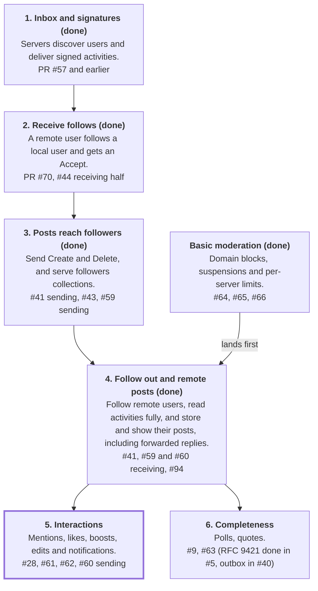

# Elysium federation implementation plan

## Where things stand

Other servers can discover Elysium's users, deliver signed activities to them, follow them, and receive their new and deleted posts, and are told when an account is suspended or deleted. Elysium's users can find and follow accounts on other servers, and their posts are stored and shown in the home timeline, updated when they're edited, and removed when they're deleted, and replies to them are stored and shown in threads, including ones forwarded by a third server. The next goal is interactions in both directions (milestone 5), and #1 tracks the full ActivityPub list.

| Area | State | Notes |
| --- | --- | --- |
| WebFinger, NodeInfo, actor and `Note` documents | Live | Mastodon, GoToSocial and Misskey resolve users in the federation lab |
| HTTP Signatures, cavage and RFC 9421 | Live | Verifying on inboxes, and signing key fetches and deliveries, cavage first. #5 |
| Inboxes | Live, partly | `Follow`, `Like`, `Announce`, their `Undo`s, `Accept` and `Reject` of a `Follow`, `Create` of a `Note`, `Update` of an actor or a `Note`, and `Delete` are acted on, and other types are stored and ignored. Forwarded activities are fetched from their origin, `sharedInbox` is advertised, and local recipients are worked out, which finishes #39 |
| Delivery and signed `POST` | Live, partly | `Follow`, `Like`, `Announce`, `Undo`, `Accept`, `Create`, `Update` of an actor, and `Delete` are sent, and `federation/smoke.sh` checks that Mastodon, GoToSocial and Misskey accept each of them |
| Job queue and backoff | Live | Load tested on one node with `./gradlew loadTest`, and not with several nodes or a real server |
| Receiving follows, remote actors | Live | Follows of local users are accepted automatically, and unfollows work, on all three lab servers. Merged in PR #70 |
| Sending follows | Live | Local users can follow local and remote users, found through WebFinger or a URL, with `Accept`, `Reject` and `Undo` handled. Checked on all three lab servers. Merged in PR #89, #44 |
| Followers and following collections | Live | Both are paged, and users can hide what's in them. Merged in PR #89, #43 |
| Posts between servers | Live, partly | New public, unlisted and followers-only posts are sent, merged in PR #72. Received `Note`s for local users are stored and shown in the API, including a home timeline (#41), received `Update`s edit them and refresh actors (#60), and received `Delete`s remove them and deleted actors (#59). Replies to a followed account's posts are stored even when forwarded, and `/statuses/:id/context` shows threads. Outboxes are served, with public and unlisted posts and boosts (#40), and following a remote account backfills the first page of its outbox (#104). Attachments are sent and read, and other servers' are downloaded and pruned after a while (#102) |
| Likes, boosts, edits, polls | Live, partly | Likes in both directions (#61, PR #118). Boosts in both directions, including of other servers' posts, with a `shares` collection (#62). Sending edits is the rest of #60, and polls are only listed on #1 |
| Moderation and server policy | Live, partly | Domain blocks (#64, PR #82), suspending and deleting accounts (#65, PR #83), and limits on what each server can have stored (#66, PR #88). Blocks that only reject a server's media, and rejecting one account's media (#102). Users' own blocks, mutes and server blocks, with blocks sent as `Block` unless an admin turns that off (#103). Reports, received and forwarded as `Flag` signed by the instance actor (#68). Silencing and the rest are under #37 |

## Roadmap

Milestones 1 to 4 and basic moderation are done. Milestone 5, interactions, is next.

Milestones 3 to 5 run in order because each uses what the last one built. Moderation can start at any time, and milestone 6 can be picked up in any order alongside milestone 5.

## Milestones

Each milestone ends with something a person on another server can see, and with a lab check that proves it. No dates are set.

### 1. Inbox and signatures (done)

Merged in PR #57. Real servers deliver signed activities, and Elysium fetches their keys and stores the activities.

### 2. Receive follows (done)

- **Issues:** the receiving half of #44, merged in PRs #70 and #71.
- **Delivers:** remote actors stored, the first code in `graph`, the first handler, and the first real signed delivery. Every `Follow` was accepted automatically at first, and manual approval came later, with #58.
- **Done when:** a Mastodon or GoToSocial user can follow and unfollow a local user in the lab.
- **Result:** `federation/smoke.sh` now follows, unfollows and follows again on all three servers, and checks the `follow` table each time. On Misskey it unfollows a second time, which reuses the `Undo` ID (#69).

### 3. Posts reach followers (done)

- **Issues:** the sending half of #41, merged in PR #72, #43, and #59 for sending `Delete`.
- **Delivers:**
  - a new status event from `content`, built into a `Create` by `activitypub`
  - followers collections, and `Note` addressing that includes them
  - using other servers' shared inboxes, and a `Delete` when a status is removed, which `ActivityDeliveries.cancel` was built to support
  - the parent's author addressed on replies, as #41 requires
- **Done when:** a remote follower sees a new post and sees it disappear when deleted.
- **Result:** PR #72 sends `Create`, uses other servers' shared inboxes, and addresses `Note` objects to followers and to the parent's author on replies, with no `Mention` tag. `followers` only gives its size. `federation/smoke.sh` now posts a public and a followers-only status, and all three servers have to store each with the right visibility. All three also have to show them in the lab user's home timeline or feed.
- **Sending `Delete` (#59):** deleting a status cancels any `Create` that hasn't started sending, and sends a `Delete` to followers. Someone who follows after a followers-only status was posted gets neither its `Create` nor its `Delete`. A status being queued holds off its deletion until its `Create` can be cancelled. A deleted public or unlisted status answers with a `Tombstone` and a `410`. `federation/smoke.sh` checks that each server removes both statuses.
- **Load:** `./gradlew loadTest` sends one activity through the real scheduler with production settings, to a loopback server that takes 200 ms to answer. Waiting jobs were refused almost all at once at each poll, so a host only got a few deliveries every 10 seconds. Jobs that can't get a slot now take turns, about 3 a second, polls are every second instead of every 10, and those jobs don't read the database. 10 connections are enough: threads did wait for one at peak, but no run failed.

  | Scenario | Before | After |
  | --- | --- | --- |
  | 1000 inboxes on one host | 322 delivered in 10 minutes, about 31 minutes in all, at 101 runs per delivery | 334 seconds, at 2.00 runs per delivery |
  | 2000 inboxes across 500 hosts | 17 seconds, at 1.00 runs per delivery | 8 seconds, at 1.24 runs per delivery |

- **Other checks:** deliveries now count key fetches against their limit per host, and leave a connection for them (`HostRequests`). Fetches only count each other, so a fan-out can't refuse them, which means one can still wait a moment for a connection. Retrying a job that's outlived its activity fails with the reason (#55). A `Delete` waits while its cancelled `Create` is running for the same host, so that it can't overtake one being sent.
- **Left open:**
  - a host that answers slowly gets fewer deliveries than turns, so its waiting jobs keep running at about 3 a second. With a large backlog, that's about 259,000 runs a day, kept for 7 days as successful history rows. This comes from reading the code, not from measuring it
  - jobs waiting for a slot have no limit on their age, so a large enough backlog on a slow host can send activities days late. The 3-day limit only applies while a host is backing off
  - a `Delete` also waits for a `Create` job left running by a node that died, until another node notices
  - a backlog for one fast host drains at about 180 a minute, well below what its connections could carry
  - actor document fetches weren't counted in the per-host limit. Every document fetch is counted now, with milestone 4's #94
  - replies haven't reached a remote server, because parents are always local until milestone 4. Public and unlisted replies to a stored remote status now go to its author, and followers-only ones don't
  - three `Create`s weren't stored on GoToSocial within about 30 seconds during testing, for a reason that wasn't found, though four timed runs took 5-6 seconds (PR #72)

### 4. Follow out and remote posts (done)

This was the largest step, and the first where other servers' content is stored and shown to users. Basic moderation had to land first.

- **Issues:** the receiving halves of #41, #59 and #60, the sending half of #44, the rest of #39, and #94.
- **Delivers:**
  - client follow endpoints, and resolving remote accounts (done)
  - remote statuses with sanitized HTML (done)
  - a home timeline (done)
  - `to` and `cc` normalizing and local recipients from #39, forwarded activities fetched from their origin, and `sharedInbox` advertised (done)
- **Done when:** a local user follows a remote user and reads their posts, including replies forwarded by a third server.
- **Following out:** merged in PR #89. Local users find remote accounts through WebFinger or a URL, and follow and unfollow them. The `Accept` or `Reject` is matched by the `Follow`'s ID, which is new for each request, or by the two actors. Deleting an account sends an `Undo` for each of its follows. `federation/smoke.sh` has the lab user accept and drop a follow from Elysium on all three servers, approving it by hand on GoToSocial.
- **Reading activities:** the rest of #39. Forwarded activities are fetched from their `id`'s origin in a job, and only the origin's copy is stored. `LocalRecipients` works out who an activity is for from its addressing, the sender's `followers` collection, now stored for remote actors, and a `Follow`'s `object`. Actor documents advertise `/inbox` as `endpoints.sharedInbox`.
  - Left open: forwarded activities that their origin doesn't serve are lost, apart from `Delete`s, which are checked with the object's server (see receiving `Delete` below). A `Create` could be checked the same way, by fetching its object.
  - Left open: the check of real deliveries on a public deployment, from the comment on #39.
- **Receiving `Create`:** the receiving half of #41. A `Note` is stored only if `LocalRecipients` finds someone for it, and replies that arrive before their parent are linked when it does, and direct ones are skipped until mentions (#28) give them someone who can see them. Its `attributedTo` has to be the activity's actor, and its `id` on the actor's server. One sent as an ID is fetched from there. HTML is sanitized with jsoup, keeping about what Mastodon keeps. Status IDs come from arrival, not `published`, so that clients paging by ID don't miss one. The API shows remote statuses, and `timelines/public` takes `local` and `remote`, while web pages stay local. A domain block removes the server's statuses, and a suspended actor's are kept but hidden, so that they come back if the suspension ends, which answers the question on #41.
  - Left open: `Article`, `Page` and `Question` are ignored, and tags other than `Mention` and `Hashtag`, emoji and `contentMap` languages other than the first aren't read. Attachments are read and downloaded since #102. Re-fetching a pruned copy on demand, as Mastodon can, is left open.
  - Left open: there's no limit on how many statuses a server can have stored, beyond the inbox's rate limits.
- **Home timeline:** `GET /api/v1/timelines/home` is a query over stored statuses, with the viewer's accepted follows passed in, rather than a feed kept for each user as Mastodon does. Following shows an account's stored statuses straight away, and unfollowing hides them, with nothing to fill or clean up. A followed account's replies follow Mastodon's rule: only to the author, the viewer, or someone followed. The viewer's own are all listed. `federation/smoke.sh` has the lab user post with no mention while alice follows them, and checks it reaches her home timeline.
  - Left open: the query takes every followed account's ID, as one array parameter, so it gets slower for someone who follows thousands. A stored feed is the fix if that's ever measured to matter.
  - Left open: a reply to a status that isn't stored is left out, since its parent's author isn't known.
- **Receiving `Delete`:** the receiving half of #59. A status is removed if its author is the signer, and an actor deleting itself loses its statuses, follows and profile through `AccountCleanupTask`, with nothing sent. Its row is kept with `deleted_at` set, and the URI is refused from then on, which was chosen over letting a reused URI come back. A `Delete` that runs before its `Create` leaves a marker in `deleted_remote_status`, by URI and author, which `storeRemote` checks under the same per-URI lock, and `JobCleanupTask` prunes after `Jobs.ACTIVITIES_KEPT`. A `Delete` that can't be shown to come from its actor is checked by fetching its object, and acted on for a `Tombstone`, or a `404` or `410` for the actor or a public or unlisted status, since servers also answer those for followers-only statuses they won't show: forwarded ones their origin doesn't serve, and an actor's own `Delete` signed with a key that's now gone, as Mastodon's are, or sent by an actor suspended here, whose statuses would otherwise stay stored for good. The second is only taken for actors stored here, so it can't be aimed at any URL. `federation/smoke.sh` has each server delete the lab user's status that mentions alice, and delete a second account, and checks that Elysium removes both. GoToSocial only sends an account's `Delete` to its followers, after withdrawing its own follows, so there alice follows the account, and on the others it follows alice. Misskey can't delete its admin, which is the lab user.
  - Left open: the lab's account `Delete`s were all verified with a key fetched earlier, so the path for a gone key is only covered by integration tests. A real Mastodon account deleted more than 24 hours after this server last fetched its key, or after a restart, would take it.
  - Left open: a `Delete` of an actor that isn't stored is ignored, so nothing stops a `Follow` or `Create` from it processed later, though its server would refuse to serve the actor by then.
  - Left open: a deleted status's replies stay, keeping their parent's URI, as Mastodon does.
- **Receiving `Update`:** the receiving half of #60. An actor updating itself has its document fetched again, rather than read from the activity, because not every server gives actors an `updated`, so the current document is the only way to cope with `Update`s that run out of order. Keys that the new document dropped or changed are forgotten from `PublicKeyResolver`'s cache, which otherwise keeps them for a day and only refetches one after a signature fails. A `Note` goes through `ActorNotes`, the checks shared with `Create`, and a stored status is only changed by its author. One that isn't stored is stored through `NoteStorage`, the rest of what `Create` does, if it was published within 3 days, since its `Create` can run later. Older ones are ignored, so that editing an old post can't make it look new here, because status IDs come from arrival. Its `updated` is stored as `edited_at`, and an `Update` that isn't newer, or has no `updated`, is ignored. Only what an edit can change on Mastodon is replaced, so visibility and the parent stay. A `Create` whose `Note` has an `updated` after its `published` stores it as edited, so an older `Update` can't replace it. The API shows `edited_at`.
  - Left open: an edit of a post more than 3 days old that was never stored here, such as one from before a follow, is ignored, and so is one whose `Create` is held up for longer than that.
  - Left open: earlier versions aren't kept, so there's no `GET /api/v1/statuses/:id/history`, and nobody is told about an edit until notifications (milestone 5).
  - Left open: remote profiles, such as names, bios and avatars, still aren't stored, so an actor `Update` only refreshes what a `Follow` stores. Polls' `Update`s belong with polls.
  - Left open: a `Note` without `updated` is never applied. Mastodon and GoToSocial send one with an edit, but a server that doesn't will have its edits ignored.
  - Left open: Mastodon's `Update` IDs have a fragment, so a forwarded one is lost, like other forwarded activities that their origin doesn't serve.
- **Forwarded replies:** a public or unlisted `Note` that `LocalRecipients` finds nobody for is still stored if its `inReplyTo` is a stored status whose author is local or followed here (`LocalRecipients.repliesToSomeoneHere`), which is Mastodon's `responds_to_followed_account?`. That's what a reply forwarded by Mastodon looks like: it addresses the replier's followers and the parent's author, not the parent author's followers. `GET /api/v1/statuses/:id/context` shows the thread from what's stored, with Mastodon's limits for anonymous requests, so a local user can read replies by people they don't follow.
  - Left open: the lab can't check this yet. Mastodon only forwards a reply with a Linked Data signature, and of the lab's servers only Mastodon adds one: Misskey only signs relay deliveries, and GoToSocial never does. A check needs a second Mastodon as the origin. Integration tests cover it with a stub origin.
  - Left open: a reply that arrives before its parent is ignored, since the parent's author isn't known. Mastodon fetches the parent instead.
  - Left open: `/context` doesn't fetch missing parents or replies, and filters what the viewer can't see after its limits, so it can list fewer than Mastodon would.
- **Limiting fetches per target host (#94):** every `ActivityDocuments` fetch counts against `HostRequests`, apart from key fetches, which `PublicKeyResolver` already counts for the whole lookup. Fetches made on another server's word, of forwarded activities and of objects in deletion checks, also take a turn from `TargetFetchTurns`: 60 a minute per host with bursts of 60, spaced like a generic cell rate algorithm. A job over that is rescheduled once to its turn, which it carries in its data so its next run doesn't take another, and it's dropped if the turn is more than an hour away. A forwarded `Delete` that its origin doesn't serve now queues its deletion check as a job, so that its second fetch takes its own turn.
  - `./gradlew loadTest` after the change, since deliveries share `HostRequests` with fetches: 1000 inboxes on one host took about 339 seconds at 2.12 runs per delivery, and 2000 across 500 hosts 8 seconds at 1.24, with no failed runs. Deliveries don't fetch documents, so this is the same as before within noise.
  - Left open: turns are per node and in memory, like `HostGate`, so the real rate is 60 a minute times the number of nodes, and a restart forgets them.
  - Left open: a flood aimed at one host can make a legitimate forward or `Delete` to it wait up to an hour, or be dropped.
  - Left open: a fetch refused by `HostRequests` fails as temporary, so an inbound job retries a minute later, and `RemoteActorLookup` answers the client with an error.

### Basic moderation (done)

- **Issues:** #64, #65 and #66, under #37, merged in PRs #82, #83 and #88. #67 and #68 are also under #37, but don't block milestone 4.
- **Delivers:** blocking a domain or an actor, checked on inbound activities and on delivery. Per-server limits on stored activities also fit here, closing the gap noted on PR #57.
- **Done when:** a blocked server's deliveries are refused, and it receives nothing from this server.
- **Result:** a domain block refuses its deliveries and key fetches, sends it nothing, and removes follows to and from its actors. Suspending a remote actor does the same for that actor. A local account can be suspended, which other servers are told with an `Update`, or deleted, which sends a `Delete`. `federation/smoke.sh` checks that all three servers receive these. Each server can deliver a limited number of activities and bytes, which admins can change.

### 5. Interactions

- **Issues:** #28, #61, #62, and the sending half of #60.
- **Delivers:** mentions, likes, boosts and edits in both directions, and notifications, which also unblock how #58 tells people about requests.
- **Done when:** a like, a boost and a mention each arrive in both directions in the lab.

### 6. Completeness

- **Issues:** #9, #63, and the `Question` item on #1. #5, #40 and #104, RFC 9421, the outbox and backfill, are done.
- **Delivers:** polls, pinned posts and quote posts. #58 is done. None of these block ordinary federation, so they can be picked up in any order.
- **Quote posts (#9):** FEP-044f in both directions, as Mastodon 4.5 does it, with the older `_misskey_quote`, `quoteUrl`, `quoteUri` and FEP-e232 `Link` read and, once a quote is approved, sent. A quote with only the older properties is shown, and a status that doesn't advertise an `interactionPolicy` can be quoted, since its server can't ask for consent. Local quotes are approved at once by the quoted status's policy, and a `QuoteRequest` of a local status is answered the same way, with a `QuoteAuthorization` served at `/users/{username}/quote_authorizations/{id}`. Remote quotes are checked in a `quote-verification` job, which fetches the quoted status and the approval, each taking a `TargetFetchTurns` turn, and doesn't fetch what a fetched status quotes in turn. An approval or revocation changes a local quote with an `Update` whose `updated` is a second later than anything sent before, and a remote `Update` that changes nothing an edit can isn't kept as a version any more. `/api/v2/instance` reports API version 7, so clients offer quoting.
  - `federation/smoke.sh` has Elysium and Mastodon quote each other, with approvals on both sides and a revocation, and has Misskey and Elysium quote each other with the older properties. GoToSocial's posts only let their author quote them, so there it only checks that Elysium refuses.
  - Left open: approval by hand, and checking approvals again later, which FEP-044f suggests. A revocation that isn't sent here isn't seen.
  - Left open: a remote revocation of a local quote is sent on as an `Update` rather than by forwarding the `Delete`, since forwarding needs a Linked Data signature.
  - Left open: blocking someone doesn't revoke their quotes, a quote can't be changed or removed by an edit, and a rejected quote can't ask again.
  - Left open: web pages only show a quote's fallback link.

## Work across milestones

These don't belong to one milestone, but each has a point where it stops being optional.

| Work | When it matters | Source |
| --- | --- | --- |
| Extend `federation/smoke.sh` with each milestone's check, on all three servers | Every milestone | The lab found problems that unit tests couldn't on PR #57 |
| Keep `FEDERATION.md` and `CHANGELOG.md` accurate in the same PR | Every milestone | `CLAUDE.md` |
| Check real delivery on a public deployment, not only the lab | Before any public server | Comment on #39 |
| Limit inbox requests that don't start a key fetch, or document relying on a proxy | Before any public server | PR #57 known limits |
| Stop each anonymous visit to a page with a form storing a login session, which has no limit | Before any public server | Code review of PR #84, and `docs/accounts.md` |
| Report GoToSocial's stuck home timeline upstream, after confirming the cause | When someone can look into it, since it doesn't block federation | PR #72 |

## Open questions

Basic moderation landing before milestone 4 is confirmed. The rest of the order is still a proposal.

- [x] Does basic moderation have to land before milestone 4, as proposed? The alternative is a faster path to remote posts, on the basis that the docs already warn against public use. Answer: Yes
- [x] Should an actor's inbox have to be on the actor's own host? Answer: Yes, as merged in PR #70. A shared inbox on another host is only left out.
- [ ] Should `Question` get an issue too? The activity types now have #59 to #63, but it's an object, so it's still only a checklist item on #1.
- [x] Should unlisted statuses be in the outbox? Answer: Yes, as on Mastodon. They can already be fetched one by one, and followers' servers are sent them anyway.
- [x] Should people be able to hide what's in their followers and following collections? Answer: Yes, as an option. Built for #43, as one setting that covers both collections and the API's lists.
- [ ] Should mentions of remote users show the domain? Open on #28.
- [x] Can a follower left behind by a retried `Follow` receive followers-only statuses, or can the case be told apart from a re-follow? Answer: No. PR #71 ignores a repeat after an Undo as a retry, since Misskey, Sharkey and Mastodon make a new ID for each request.
