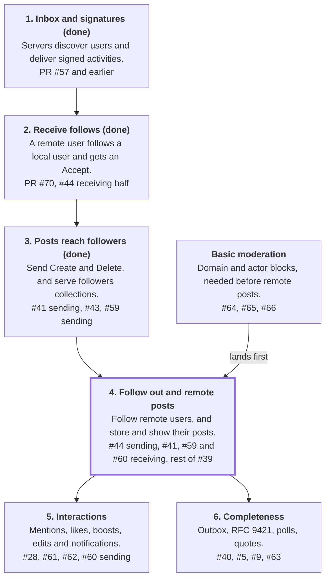

# Elysium federation implementation plan

## Where things stand

Other servers can discover Elysium's users, deliver signed activities to them, follow them, be followed by them, and receive their new and deleted posts, but Elysium ignores posts from other servers, so it can't fully federate yet. The next goal is a two-way relationship with Mastodon and GoToSocial, and #1 tracks the full ActivityPub list.

| Area | State | Notes |
| --- | --- | --- |
| WebFinger, NodeInfo, actor and `Note` documents | Live | Mastodon, GoToSocial and Misskey resolve users in the federation lab |
| HTTP Signatures, cavage | Live | Verifying on inboxes, and signing key fetches and deliveries. RFC 9421 is open in #5 |
| Inboxes | Live, partly | `Follow`, `Undo` of a `Follow`, and `Accept` and `Reject` of a `Follow` are acted on, and other types are stored and ignored. #39 stays open for forwarded activities, `sharedInbox` and normalizing |
| Delivery and signed `POST` | Live, partly | `Accept`, `Create` and `Delete` are sent, and `federation/smoke.sh` checks that Mastodon, GoToSocial and Misskey accept each of them |
| Job queue and backoff | Live | Load tested on one node with `./gradlew loadTest`, and not with several nodes or a real server |
| Receiving follows, remote actors | Live | Follows of local users are accepted automatically, and unfollows work, on all three lab servers. Merged in PR #70 |
| Sending follows | Live, not yet checked in the lab | Local users can follow local and remote users, found through WebFinger or a URL, with `Accept`, `Reject` and `Undo` handled. #44 |
| Followers and following collections | Live | Both are paged, and users can hide what's in them. #43 |
| Posts between servers | Live, partly | New public, unlisted and followers-only posts are sent, merged in PR #72. Receiving is in #41, and the outbox is in #40 |
| Likes, boosts, edits, polls, receiving deletes | Missing | #60, #61, #62, #59, with polls only listed on #1 |
| Moderation and server policy | Partly | Domain blocks are in #64. The rest is under #37 |

## Roadmap

Milestone 3 is done, so the next step is milestone 4. It's the riskiest, because it stores other servers' posts, so it waits on moderation.

Milestones 3 to 5 run in order because each uses what the last one built. Moderation can start at any time, and milestone 6 can be picked up in any order alongside milestone 5.

## Milestones

Each milestone ends with something a person on another server can see, and with a lab check that proves it. No dates are set.

### 1. Inbox and signatures (done)

Merged in PR #57. Real servers deliver signed activities, and Elysium fetches their keys and stores the activities.

### 2. Receive follows (done)

- **Issues:** the receiving half of #44, merged in PRs #70 and #71.
- **Delivers:** remote actors stored, the first code in `graph`, the first handler, and the first real signed delivery. Every `Follow` is accepted automatically, and manual approval is in #58.
- **Done when:** a Mastodon or GoToSocial user can follow and unfollow a local user in the lab.
- **Result:** `federation/smoke.sh` now follows, unfollows and follows again on all three servers, and checks the `follow` table each time. On Misskey it unfollows a second time, which reuses the `Undo` ID (#69).

### 3. Posts reach followers (done)

- **Issues:** the sending half of #41, merged in PR #72, #43, and #59 for sending `Delete`.
- **Delivers:**
  - a new status event from `content`, built into a `Create` by `activitypub`
  - followers collections, and `Note` addressing that includes them
  - using other servers' shared inboxes, and a `Delete` when a status is removed, which `ActivityDeliveries.cancel` was built to support
  - the parent's author addressed on replies, as #41 requires
- **Done when:** a remote follower sees a new post and sees it disappear when deleted.
- **Result:** PR #72 sends `Create`, uses other servers' shared inboxes, and addresses `Note` objects to followers and to the parent's author on replies, with no `Mention` tag. `followers` only gives its size. `federation/smoke.sh` now posts a public and a followers-only status, and all three servers have to store each with the right visibility. All three also have to show them in the lab user's home timeline or feed.
- **Sending `Delete` (#59):** deleting a status cancels any `Create` that hasn't started sending, and sends a `Delete` to followers. Someone who follows after a followers-only status was posted gets neither its `Create` nor its `Delete`. A status being queued holds off its deletion until its `Create` can be cancelled. A deleted public or unlisted status answers with a `Tombstone` and a `410`. `federation/smoke.sh` checks that each server removes both statuses.
- **Load:** `./gradlew loadTest` sends one activity through the real scheduler with production settings, to a loopback server that takes 200 ms to answer. Waiting jobs were refused almost all at once at each poll, so a host only got a few deliveries every 10 seconds. Jobs that can't get a slot now take turns, about 3 a second, polls are every second instead of every 10, and those jobs don't read the database. 10 connections are enough: threads did wait for one at peak, but no run failed.

  | Scenario | Before | After |
  | --- | --- | --- |
  | 1000 inboxes on one host | 322 delivered in 10 minutes, about 31 minutes in all, at 101 runs per delivery | 334 seconds, at 2.00 runs per delivery |
  | 2000 inboxes across 500 hosts | 17 seconds, at 1.00 runs per delivery | 8 seconds, at 1.24 runs per delivery |

- **Other checks:** deliveries now count key fetches against their limit per host, and leave a connection for them (`HostRequests`). Fetches only count each other, so a fan-out can't refuse them, which means one can still wait a moment for a connection. Retrying a job that's outlived its activity fails with the reason (#55). A `Delete` waits while its cancelled `Create` is running for the same host, so that it can't overtake one being sent.
- **Left open:**
  - a host that answers slowly gets fewer deliveries than turns, so its waiting jobs keep running at about 3 a second. With a large backlog, that's about 259,000 runs a day, kept for 7 days as successful history rows. This comes from reading the code, not from measuring it
  - jobs waiting for a slot have no limit on their age, so a large enough backlog on a slow host can send activities days late. The 3-day limit only applies while a host is backing off
  - a `Delete` also waits for a `Create` job left running by a node that died, until another node notices
  - a backlog for one fast host drains at about 180 a minute, well below what its connections could carry
  - actor document fetches aren't counted in the per-host limit, so they can still wait for a connection
  - replies haven't reached a remote server, because parents are always local until milestone 4
  - three `Create`s weren't stored on GoToSocial within about 30 seconds during testing, for a reason that wasn't found, though four timed runs took 5-6 seconds (PR #72)

### 4. Follow out and remote posts

This is the largest step, and the first where other servers' content is stored and shown to users. Basic moderation has to land first.

- **Issues:** the sending half of #44, the receiving half of #41, the rest of #39, and the receiving halves of #59 and #60.
- **Delivers:**
  - client follow endpoints, and resolving remote accounts
  - remote statuses with sanitized HTML, which `Status` currently assumes is safe
  - a home timeline
  - `to` and `cc` normalizing and local recipients from #39, forwarded activities fetched from their origin, and `sharedInbox` advertised
- **Done when:** a local user follows a remote user and reads their posts, including replies forwarded by a third server.

### Basic moderation

- **Issues:** #64, #65 and #66, under #37. #67 and #68 are also under #37, but don't block milestone 4.
- **Delivers:** blocking a domain or an actor, checked on inbound activities and on delivery. Per-server limits on stored activities also fit here, closing the gap noted on PR #57.
- **Done when:** a blocked server's deliveries are refused, and it receives nothing from this server.

### 5. Interactions

- **Issues:** #28, #61, #62, and the sending half of #60.
- **Delivers:** mentions, likes, boosts and edits in both directions, and notifications, which also unblock how #58 tells people about requests.
- **Done when:** a like, a boost and a mention each arrive in both directions in the lab.

### 6. Completeness

- **Issues:** #40, #5, #9, #63, and the `Question`, likes and shares items on #1.
- **Delivers:** outbox backfill, RFC 9421, polls, pinned posts, quote posts and #58. None of these block ordinary federation, so they can be picked up in any order.

## Work across milestones

These don't belong to one milestone, but each has a point where it stops being optional.

| Work | When it matters | Source |
| --- | --- | --- |
| Extend `federation/smoke.sh` with each milestone's check, on all three servers | Every milestone | The lab found problems that unit tests couldn't on PR #57 |
| Keep `FEDERATION.md` and `CHANGELOG.md` accurate in the same PR | Every milestone | `CLAUDE.md` |
| Remove a follower when its actor is deleted | Milestone 4, with receiving #59 | Left out of PR #70 |
| Check real delivery on a public deployment, not only the lab | Before any public server | Comment on #39 |
| Limit inbox requests that don't start a key fetch, or document relying on a proxy | Before any public server | PR #57 known limits |
| Email verification and sign-up approval | Before any public server | #35, #17, and the warning in `docs/accounts.md` |
| Stop each anonymous visit to a page with a form storing a login session, which has no limit | Before any public server | Code review of PR #84, and `docs/accounts.md` |
| Handling a `Delete` that arrives before its `Create` | Milestone 4 | #53 left ordering to the callers |
| Report GoToSocial's stuck home timeline upstream, after confirming the cause | When someone can look into it, since it doesn't block federation | PR #72 |

## Open questions

Basic moderation landing before milestone 4 is confirmed. The rest of the order is still a proposal.

- [x] Does basic moderation have to land before milestone 4, as proposed? The alternative is a faster path to remote posts, on the basis that the docs already warn against public use. Answer: Yes
- [x] Should an actor's inbox have to be on the actor's own host? Answer: Yes, as merged in PR #70. A shared inbox on another host is only left out.
- [ ] Should `Question` get an issue too? The activity types now have #59 to #63, but it's an object, so it's still only a checklist item on #1.
- [ ] Should unlisted statuses be in the outbox? Open on #40.
- [x] Should people be able to hide what's in their followers and following collections? Answer: Yes, as an option. Built for #43, as one setting that covers both collections and the API's lists.
- [ ] Should mentions of remote users show the domain? Open on #28.
- [x] Can a follower left behind by a retried `Follow` receive followers-only statuses, or can the case be told apart from a re-follow? Answer: No. PR #71 ignores a repeat after an Undo as a retry, since Misskey, Sharkey and Mastodon make a new ID for each request.
